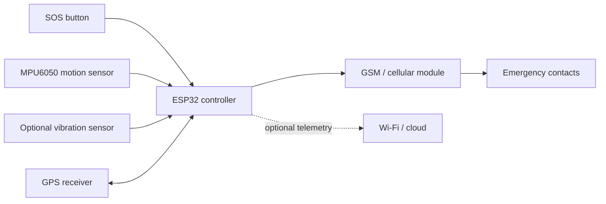

# AI + IoT Women Safety Device

A safety-focused ESP32 prototype concept that combines a manual SOS trigger, motion sensing, GPS location, and cellular emergency alerts.

> **Project status:** Concept and implementation plan. The supplied brief does not confirm assembled hardware, tested firmware, a trained AI model, measured accuracy, or end-to-end alert delivery. This repository keeps those boundaries visible.

## What it does

1. Monitors motion-related sensor inputs.
2. Lets the user trigger an SOS independently of any AI model.
3. Reads a valid position from a dedicated GPS receiver.
4. Sends an SMS or call through a compatible cellular module.
5. Leaves room for a small, validated motion-activity classifier.

The manual SOS path is the primary safety mechanism. Sensor patterns can support a decision, but they cannot reliably determine whether a person is in danger on their own.

## System at a glance

Detailed diagrams are in [`hardware/diagrams`](hardware/diagrams/). The diagrams are original documentation assets generated from the supplied design brief; they are not evidence of a completed PCB or tested wiring.

## Repository map

- [`firmware/esp32_safety_device/esp32_safety_device.ino`](firmware/esp32_safety_device/esp32_safety_device.ino): conservative Arduino scaffold with a manual SOS path.
- [`hardware/bill-of-materials.csv`](hardware/bill-of-materials.csv): proposed components and validation notes.
- [`hardware/diagrams/`](hardware/diagrams/): block diagram, circuit concept, flowchart, GPS alert sequence, and PCB concept.
- [`docs/project-status.md`](docs/project-status.md): what is known, proposed, and still to be tested.
- [`docs/testing.md`](docs/testing.md): staged verification checklist.
- [`docs/ai-plan.md`](docs/ai-plan.md): honest plan for motion-activity classification.
- [`assets/AI-IoT-Womens-Safety-Device-Infographic.png`](assets/AI-IoT-Womens-Safety-Device-Infographic.png): supplied infographic.

## Proposed pin plan

| Function | ESP32 pin | Interface |
| --- | ---: | --- |
| MPU6050 SDA | GPIO 21 | I2C |
| MPU6050 SCL | GPIO 22 | I2C |
| GPS RX/TX | GPIO 16 / 17 | UART2 |
| GSM RX/TX | GPIO 26 / 27 | UART |
| SOS button | GPIO 18 | `INPUT_PULLUP` |
| Optional vibration input | GPIO 19 | Digital |

These pins are examples from the supplied brief. Verify the exact board, module voltage levels, boot-strapping conflicts, and power requirements before wiring.

## Safety and privacy boundaries

- Do not commit real phone numbers, API keys, SIM credentials, personal locations, audio, or raw sensor recordings.
- A GPS fix must be validated before a location is included in an alert.
- Cellular modules need a properly sized supply for transmission current peaks.
- This prototype is a supplementary aid, not a guaranteed emergency-response service.
- Test only with consent and controlled, non-emergency scenarios.

## Current status

| Area | Status |
| --- | --- |
| Architecture and documentation | Drafted from supplied brief |
| Hardware assembly | Not confirmed |
| GPS fix and SMS delivery | Not tested |
| Firmware | Scaffold only |
| AI model and accuracy | Planned; no claims made |
| End-to-end validation | Pending |

## License

No license has been selected yet. Add one before accepting external contributions or redistributing the project.
