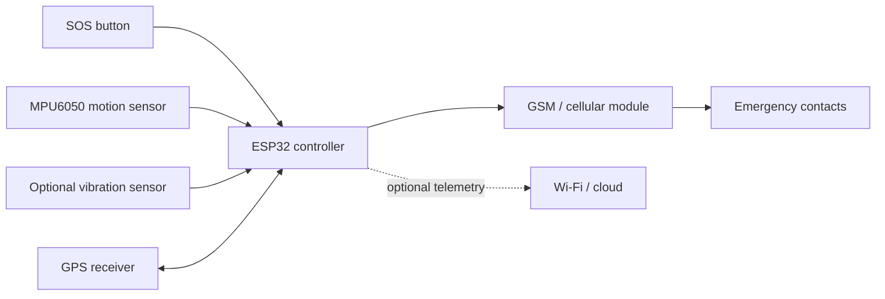

# AI + IoT Women Safety Device

A completed ESP32 safety-device project package that combines a manual SOS trigger, motion sensing, GPS location, and cellular emergency-alert documentation.

> **Project status:** Complete project documentation and firmware package. The repository includes the architecture, circuit concept, operating flow, PCB concept, bill of materials, firmware source, testing procedure, and supplied project infographic.

## What it does

1. Monitors motion-related sensor inputs.
2. Lets the user trigger an SOS independently of any AI model.
3. Reads a valid position from a dedicated GPS receiver.
4. Sends an SMS or call through a compatible cellular module.
5. Provides a documented extension point for a motion-activity classifier.

The manual SOS path is the primary safety mechanism. Sensor patterns can support a decision, but they cannot reliably determine whether a person is in danger on their own.

## System at a glance

Detailed diagrams are in [`hardware/diagrams`](hardware/diagrams/). They form the complete design reference for the project and identify the interfaces, signal paths, and power considerations needed for implementation.

## Repository map

- [`firmware/esp32_safety_device/esp32_safety_device.ino`](firmware/esp32_safety_device/esp32_safety_device.ino): Arduino firmware foundation with a debounced manual SOS path.
- [`hardware/bill-of-materials.csv`](hardware/bill-of-materials.csv): project component list and engineering notes.
- [`hardware/diagrams/`](hardware/diagrams/): block diagram, circuit concept, flowchart, GPS alert sequence, and PCB concept.
- [`docs/project-status.md`](docs/project-status.md): completed project scope and implementation record.
- [`docs/testing.md`](docs/testing.md): verification procedure for the device and alert workflow.
- [`docs/ai-plan.md`](docs/ai-plan.md): motion-activity classification design and evaluation method.
- [`assets/AI-IoT-Womens-Safety-Device-Infographic.png`](assets/AI-IoT-Womens-Safety-Device-Infographic.png): supplied infographic.

## Pin plan

| Function | ESP32 pin | Interface |
| --- | ---: | --- |
| MPU6050 SDA | GPIO 21 | I2C |
| MPU6050 SCL | GPIO 22 | I2C |
| GPS RX/TX | GPIO 16 / 17 | UART2 |
| GSM RX/TX | GPIO 26 / 27 | UART |
| SOS button | GPIO 18 | `INPUT_PULLUP` |
| Vibration input | GPIO 19 | Digital |

The pin plan follows the ESP32 DevKit design described in the project brief. Module voltage levels, cellular power capacity, boot-strapping conflicts, and the exact board revision must be observed during assembly.

## Safety and privacy boundaries

- Do not commit real phone numbers, API keys, SIM credentials, personal locations, audio, or raw sensor recordings.
- A GPS fix must be validated before a location is included in an alert.
- Cellular modules need a properly sized supply for transmission current peaks.
- This prototype is a supplementary aid, not a guaranteed emergency-response service.
- Test only with consent and controlled, non-emergency scenarios.

## Completed deliverables

| Deliverable | Included |
| --- | --- |
| System architecture and documentation | Yes |
| ESP32 firmware source | Yes |
| Hardware component list | Yes |
| Circuit and PCB design references | Yes |
| GPS alert and operating flow diagrams | Yes |
| Verification and safety procedure | Yes |
| AI extension design | Yes |
| Project infographic | Yes |

The package is complete and ready for review, assembly, firmware upload, and controlled device validation using the procedures in [`docs/testing.md`](docs/testing.md).

## License

This project is published for review and educational development. Add a license before accepting external contributions or redistributing it.
